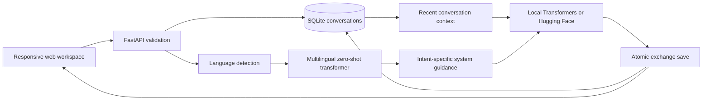

# Architecture and extension guide

## Keep changes in the right place

- **UI layout:** `web/index.html`. Styles and breakpoints live in `web/styles.css`.
- **Browser behavior:** `web/app.js`. User and model content are rendered using `textContent` to avoid HTML injection.
- **API contracts:** `app/api/routes.py`. Add request validation before invoking services.
- **Intent taxonomy and handling:** `LABELS` and `GUIDANCE` in `app/services/nlp.py`. The classifier uses English hypothesis labels across multilingual input. Evaluate new labels against representative user queries before relying on them.
- **Generation providers:** `app/services/chat.py`. Each provider receives system guidance, ordered history, and the latest user message.
- **Storage:** `app/core/database.py`. SQL statements use parameters; each complete user/assistant exchange is transactional.
- **Configuration:** `app/core/config.py`, `.env.example`, and your private `.env`.

## Operational behavior

Requests use synchronous FastAPI handlers, so inference runs in the server thread pool. A bounded lock pool serializes exchanges for the same conversation. Model locks prevent simultaneous loading and CPU generation. This is intended for one local user and one server worker; a shared service should use an inference queue and persistent per-conversation coordination.

The UI reports the configured engine, detected language, intent score (only for model inference), and number of prior messages used. It never substitutes a demo response after a real inference failure. Provider errors return HTTP 503 with a retryable explanation; full exceptions remain in server logs.

## Privacy and limitations

Conversations are plaintext in the local SQLite database. Hosted generation sends recent conversation content to Hugging Face / its selected inference provider. Local mode downloads weights and then runs generation locally. Fonts can make an optional request to Google Fonts. The app has no authentication and is bound to localhost by its start scripts.

Language detection and intent scores are estimates. The language selector controls response language; it does not promise model quality in every language. No retrieval index, document upload, external tool execution, or persistent semantic memory is included.
